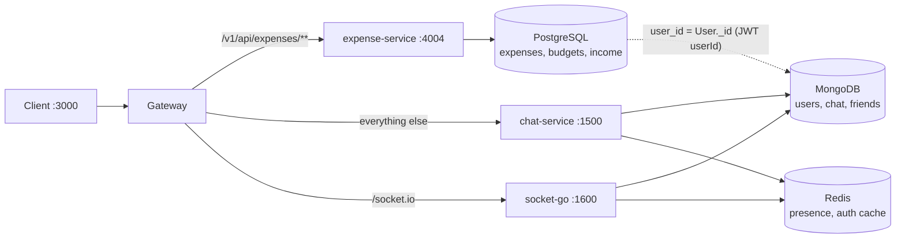
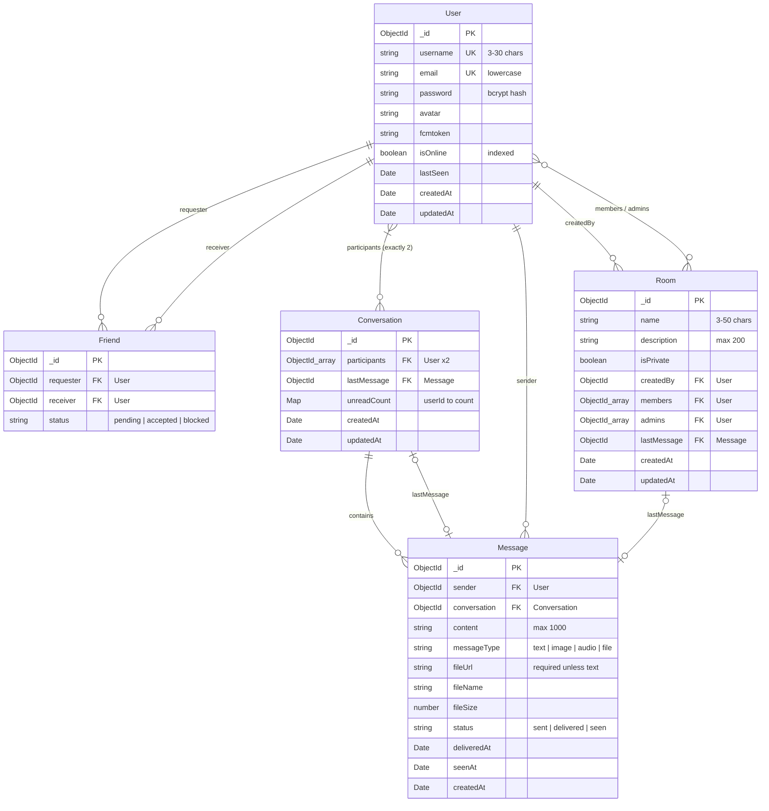
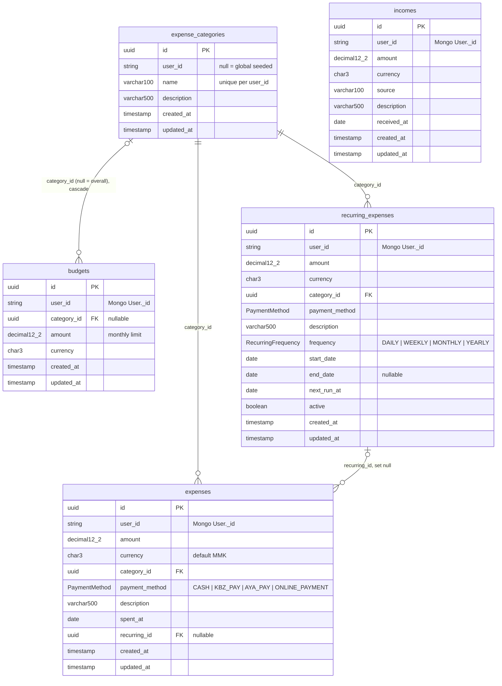

# Messaging Socket Data Model

The app keeps data in three stores. chat-service (REST) and socket-go (real-time) own users, chat and friends in MongoDB. The expense service owns money data in PostgreSQL. Redis holds short-lived presence and auth cache. The stores share one key: the Mongo `User._id`, which Postgres stores as a plain `user_id` string with no foreign key.

## How the stores connect

## MongoDB

Schemas: Mongoose models in `services/chat-service/src/models/*.ts`. socket-go (`services/socket-go/internal/store`) writes the same `users`, `conversations` and `messages` collections directly with the Go driver, keeping documents in the shape Mongoose expects (`createdAt`, `updatedAt`, `__v`).

### Indexes

- **users** username, email (unique), isOnline
- **conversations** participants, participants.0 + participants.1, lastMessage
- **messages** conversation + createdAt desc, sender, status
- **rooms** name, members, isPrivate
- **friends** none besides \_id

### Rules in code

- **Conversation** pre-save rejects anything but 2 unique participants
- **Conversation** chat-service's findOrCreateConversation sorts the 2 ids before saving. socket-go saves them as [sender, recipient]. Both look up with `$all`, so order doesn't affect lookup
- **User** pre-save hashes password (bcrypt, cost 12)
- **User** JWT payload: userId, email, username

## PostgreSQL

Schema: Prisma, `services/expense-service/prisma/schema.prisma`.

### Indexes and constraints

- **expenses** (user_id, spent_at), (user_id, category_id)
- **expense_categories** unique (user_id, name), plus partial unique name WHERE user_id IS NULL
- **budgets** unique (user_id, category_id), plus partial unique user_id WHERE category_id IS NULL
- **incomes** (user_id, received_at)
- **recurring_expenses** (user_id, active, next_run_at)

### Rules in code

- **categories** a user sees global rows plus their own; only their own can be edited
- **budgets** warning at 80% used, flagged when exceeded
- **recurring** due expenses are created on read; next_run_at guard stops duplicates
- **all tables** every query filters by user_id from the JWT

## Redis

Clients: node-redis in `services/chat-service/src/middleware/auth.ts`, go-redis in `services/socket-go/internal/presence`.

### connectedUsers

- **hash** socket.id → user entry JSON (`id`, `userId`, `username`, `socketId`, `isOnline`, `lastSeen`). Written by socket-go: set on connect, removed on disconnect.

### user:{userId}

- **string** cached user for chat-service's auth middleware, 60 s expiry. Deleted when the user changes.

## Things the schema doesn't enforce

**Friend has no timestamps.** The interface declares `createdAt` and `updatedAt`, but the schema has no `{ timestamps: true }`, so they are never saved.

**Duplicate friend requests are possible.** There is no unique index on `(requester, receiver)`, and nothing stops A→B and B→A both existing.

**Room messages have nowhere to live.** `Room.lastMessage` points at Message, but `Message.conversation` is required and there is no `room` field.

**No cross-database cleanup.** Deleting a Mongo user leaves their Postgres rows behind, because `user_id` is not a real foreign key.

**Conversation summary fields are never written.** Nothing sets `Conversation.lastMessage` or `unreadCount` (socket-go creates conversations with an empty `unreadCount`), and `Message.deliveredAt` is never set when the status changes to `delivered`.

Messages are routed per user, not per socket: socket-go puts every socket of a user in a room named after the `userId`, so several tabs and devices all receive events. Redis is not used for routing.